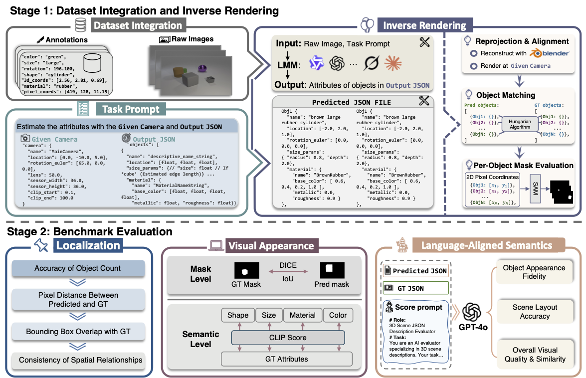

<h1 style="border: none; margin-bottom: 0;">
  IR3D-Bench: Evaluating Vision-Language Model Scene Understanding as Agentic Inverse Rendering
</h1>

*"What I cannot create, I do not understand."* *——Richard Feynman*

<p align="center">
  <a href="https://arxiv.org/abs/2506.23329"></a>
  <a href="https://ir3d-bench.github.io/"></a>
  <a href="https://youtu.be/GRQ9ZjyP5tY"></a>
</p>

<p align="center">
  
</p>

> [**IR3D-Bench: Evaluating Vision-Language Model Scene Understanding as Agentic Inverse Rendering**]()<br>
> [Parker Liu]()<sup>1,\*</sup>, [Chenxin Li](https://chenxinli001.github.io/)<sup>1,\*</sup>,
[Zhengxin Li](https://github.com/Lizx123456)<sup>2</sup>,
[Yipeng Wu](https://github.com/wind-bell999)<sup>2</sup>,
[Wuyang Li](https://wymancv.github.io/wuyang.github.io/)<sup>3</sup>,
[Zhiqin Yang](https://visitworld123.github.io/)<sup>1</sup>,
[Zhenyuan Zhang](https://openreview.net/profile?id=~Zhenyuan_Zhang2)<sup>4</sup>,
[Yunlong Lin](https://lyl1015.github.io/)<sup>5</sup>,
[Sirui Han](https://facultyprofiles.hkust.edu.hk/profiles.php?profile=sirui-han-siruihan)<sup>4</sup>,
[Brandon Y. Feng](https://brandonyfeng.github.io/)<sup>6</sup>,
<br> <sup>1</sup>CUHK, <sup>2</sup>TJU, <sup>3</sup>EPFL, <sup>4</sup>HKUST, <sup>5</sup>XMU, <sup>6</sup>MIT <br>
> NeurIPS DB 2025


# 🌟 Motivation & Useful Findings
1. Inspired by Richard Feynman's aphorism (see the header), we propose a new perspective to evaluate VLMs' spatial visual understanding via a pretext task: how well they "recreate this scene."
2. We found that the aim of scene reconstruction enables VLMs to spontaneously estimate key attributes (object ID, localization, color, material, object relations, etc.) via a inverse rendering fahsion—critical for understanding what they see.
3. VLMs shows surprising potential for human-like reflection during this "recreation" game: feeding VLMs their recreated scenes, they compare with originals and update their understanding of the secene (the key attributes they estimate). We expect this multi-round feedback iteration to unlock more possibilities for improving existing VLMs in both understanding and generation performance.

# 🎨 Pipeline Overview
<p align="center">
  
</p>


# 🛠️ Environment setup
(1) Create Environment:
```shell
conda create --name ir3d python=3.10
conda activate ir3d
```

(2) Install the common inference and evaluation dependencies:
```shell
pip install -r requirements.txt
```
For local open-weight inference, also install [vLLM](https://github.com/vllm-project/vllm) in a compatible CUDA environment:
```
pip install vllm
```

(3) Install Blender [on linux](https://docs.blender.org/manual/en/latest/getting_started/installing/linux.html)
```shell
snap install blender --classic
```
(4) Download the **ViT-H** checkpoint linked in the [SAM model checkpoints](https://github.com/facebookresearch/segment-anything#model-checkpoints) section, then configure its local path:
```shell
export SAM_CHECKPOINT="/absolute/path/to/sam_vit_h_4b8939.pth"
```
`requirements.txt` lists direct dependencies, not a tested version lock. The original exact package/CUDA/Blender versions have not been recorded here; installing these packages alone does not establish full reproducibility. Record the versions from a validated environment before publishing a lock file. The vLLM entry point uses version-sensitive vLLM APIs.

Use `OPENAI_API_KEY` for API credentials. `OPENAI_BASE_URL` optionally selects an OpenAI-compatible endpoint (default: `https://api.openai.com/v1`). Choose an endpoint that supports the requested model. For gated Hugging Face models, set `HF_TOKEN` or authenticate with the Hugging Face CLI; no token is embedded in the code.

# 📚 Dataset setup
Download our processed data: [IR3D-bench-data](https://huggingface.co/datasets/Piang/IR3D-bench).
The evaluation data root must contain `image/` and `json/` with matching CLEVR case names. Run the following examples from the repository root.

## Inverse Rendering
### Task prompt
Prompt for inverse rendering and gpt4o score is in `prompts/gpt4o_as_evaluator.txt` and `prompts/vlm_estimate_params.txt`
### Open-source Models (local vLLM)
Choose a supported `--model-type` from `main_vllm.py --help`. All matching `CLEVR_val_*.png` images are processed by default; use `--max-images 1` for a single-scene run.
```shell
python main_vllm.py --model-type "qwen2_5_vl_7b" \
    --image-dir /path/to/data/image \
    --output-dir ./outputs \
    --max-images 1
```
The output root contains `json/` and `render/`. Blender is resolved from `PATH`; override it with `--blender-path` or `BLENDER_PATH`. The default prompt and rendering script are resolved relative to the repository, not the caller's working directory.

### Proprietary Models (OpenAI-compatible API)
Set `OPENAI_API_KEY` in your environment before running. For a small trial, point `--image_dir` at a directory containing only the intended sample images. All supported images in that directory are considered; existing result JSON files are skipped.
```shell
python main_api.py \
    --image_dir /path/to/data/image \
    --result_dir ./outputs/json \
    --prompt_path prompts/vlm_estimate_params.txt \
    --model_name "gpt-4o"
```
## Eval
With `SAM_CHECKPOINT` and `OPENAI_API_KEY` configured:
```shell
bash cal_metric.sh "./outputs" "/path/to/data" "0"
```
Pass the data **root**, not its `image/` subdirectory. The script matches scenes, renders predictions, and computes metrics; it stops if a stage exits unsuccessfully. Relative paths are resolved from the caller's working directory. Optional environment variables: `PYTHON_BIN`, `BLENDER_PATH`, `LLM_MODEL_NAME` (default `gpt-4o`), and `OPENAI_BASE_URL`. LLM scoring calls the configured API and may incur charges.

## Local regression checks
```shell
python -m unittest discover -s tests -v
```
These checks use stubs and do not download models, call an API, or establish numerical benchmark reproducibility.

## License status
No repository-wide license has been declared yet. Existing per-file license notices remain in effect; do not infer a repository-wide reuse grant from public availability. A repository-wide license requires confirmation from the rights holders.


# 🎈 Acknowledgement
Thanks to the following fantastic repos: [SAM](https://github.com/facebookresearch/segment-anything), [vllm](https://github.com/vllm-project/vllm), [Clever dataset](https://github.com/facebookresearch/clevr-dataset-gen), [Blender](https://www.blender.org/).

# 📒 Citation
If you find our work helpful, please consider citing:
```bibtex
@article{liu2025ir3d,
  title={IR3D-Bench: Evaluating Vision-Language Model Scene Understanding as Agentic Inverse Rendering},
  author={Liu, Parker and Li, Chenxin and Li, Zhengxin and Wu, Yipeng and Li, Wuyang and Yang, Zhiqin and Zhang, Zhenyuan and Lin, Yunlong and Han, Sirui and Feng, Brandon Y},
  journal={arXiv preprint arXiv:2506.23329},
  year={2025}
}
```
